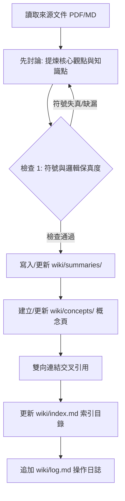
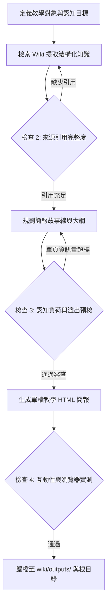

# LLM Wiki Agent Schema & Operating System (AGENT.md)

本文件定義此知識庫的架構規範、Agent 運作守則（The Schema）與工作流程。本專案參考 Andrej Karpathy 的 **LLM Wiki** 理念，建立一個持久、自主演化、具備交叉引用的個人數位知識庫，並以此知識庫為基礎，持續產出高質量的教學教材與簡報。

---

## 1. 核心理念與架構 (Three-Layer Architecture)

```
┌────────────────────────────────────────────────────────┐
│                      Raw Sources                       │
│  (sources/week1... 不可變原始材料，如課程投影片 PDF、文件)      │
└───────────────────────────┬────────────────────────────┘
                            │ Read & Ingest (提取與編譯)
                            ▼
┌────────────────────────────────────────────────────────┐
│                        The Wiki                        │
│  (wiki/ LLM 全面維護的 Markdown 知識庫，持久積累與複利)   │
│  - index.md (全站導覽與摘要地圖)                          │
│  - log.md (時間軸操作日誌)                               │
│  - concepts/ (核心概念、定理、邏輯閘)                     │
│  - summaries/ (單一來源總結導讀)                          │
│  - outputs/ (查詢與簡報沉澱產物)                          │
└───────────────────────────┬────────────────────────────┘
                            │ Query & Synthesize (查詢與生成)
                            ▼
┌────────────────────────────────────────────────────────┐
│                       The Schema                       │
│  (AGENT.md 本規範：定義工作流程、檢查閥門與驗證規則)       │
└────────────────────────────────────────────────────────┘
```

1. **不可變來源層 (`sources/`)**：外部匯入的原始 PDF、筆記或資料。Agent 僅讀取，不修改原始檔。
2. **持久 Wiki 層 (`wiki/`)**：LLM 負責編寫與持續維護的 Markdown 檔案集。所有概念均互相建立雙向連結 `[[Link]]`。
3. **規範架構層 (`AGENT.md`)**：規範 Agent 如何進行 Ingest、Query、Lint 及教學簡報產出。

---

## 2. 格式規範 (Conventions & Obsidian Compatibility)

- **雙向連結**：使用 Obsidian 規範的 `[[Page Name]]` 格式。
- **YAML Frontmatter**：每個 Wiki 頁面開頭必須包含標準元資料：
  ```yaml
  ---
  title: 頁面完整標題
  type: concept | summary | module | output
  tags: [關鍵字1, 關鍵字2]
  sources: ["[[sources/week1/filename.pdf]]"]
  created: YYYY-MM-DD
  last_updated: YYYY-MM-DD
  ---
  ```
- **語言規範**：內文以繁體中文（台灣習慣用語）為主；專有名詞保留標準英文或中英對照（如：布林代數 Boolean Algebra、邏輯閘 Logic Gates、真值表 Truth Table、狄摩根定律 De Morgan's Laws）。
- **數學與電路符號**：使用 LaTeX 或標準布林代數符號，補數使用 $A'$ 或 $\overline{A}$，乘法使用 $A \cdot B$ 或 $AB$，加法使用 $A + B$，互斥或使用 $A \oplus B$。

---

## 3. Agent 核心操作與狀態圖 (Core Operations & Graph Loop)

Agent 支援四大核心操作指令：

### 3.1 Ingest (資料攝取工作流)

- **執行原則**：
  1. 攝取前落實「**先討論、後生成**」，向使用者概述該文件核心架構並確認更新策略。
  2. 每一份原始來源在 `wiki/summaries/` 建立一篇導讀總結。
  3. 將抽取出的概念拆解為原子化的 `wiki/concepts/` 頁面（若該概念頁已存在，則融入新內容與範例，而非覆蓋舊知識）。
  4. 隨時更新 `index.md` 與 `log.md`。

### 3.2 Query (知識查詢與沉澱工作流)
- 檢索 `wiki/index.md` 定位相關概念頁面。
- 綜合多個 Wiki 頁面回答深度問題，並明確附帶 `[[wiki/concepts/...]]` 引用。
- **知識回流原則**：若查詢產出具有長期保留價值的分析、比較表或教學講義，自動存入 `wiki/outputs/`，並在 `index.md` 登錄。

### 3.3 Lint (知識庫健康檢查工作流)
- 遍歷所有 Wiki 頁面，檢查以下項目：
  1. **孤島頁面 (Orphans)**：沒有任何反向連結的頁面。
  2. **斷鏈 (Broken Links)**：引用了尚未建立的 `[[Non-Existent Page]]`。
  3. **衝突與矛盾 (Contradictions)**：不同來源之間定義或定理是否有衝突。
  4. **索引完整性 (Index Drift)**：是否有新頁面未被加入 `index.md`。

### 3.4 Generate-Slides (教學 HTML 簡報生成工作流)

- **教學簡報規範**：
  1. 鎖定完全零基礎之初學者，以直覺比喻（如開關、水流）引導至嚴謹數學定理。
  2. 簡報產出為獨立、可互動之單一 HTML 檔案，支援全螢幕、鍵盤切換與講者備忘錄。
  3. 每一頁投影片必須標註知識來源對應的 Wiki 頁面。

---

## 4. 日誌格式規範 (wiki/log.md)
日誌檔案採嚴格時間軸追加格式：
```markdown
## [YYYY-MM-DD HH:MM] 操作類型 | 標題或描述
- **涉及來源**：`sources/...`
- **更新頁面**：`wiki/concepts/...`, `wiki/summaries/...`
- **執行重點**：重點條列說明。
- **品質檢驗**：檢查項目與結果。
```

---

## 5. 品質保證與檢查前移原則 (Shift-Left Quality Strategy)
為避免在最後生成簡報時產生大量返工，本系統實施「檢查前移」策略：
1. **符號與公式檢查前移**：在 Ingest 階段即校驗布林代數運算子，杜絕後續概念頁中的符號歧義。
2. **原子化切分前移**：在概念歸檔時即限制單篇概念長度，便於簡報模組化引用。
3. **大綱審查前移**：在編寫 HTML 程式碼前，先對簡報大綱進行節奏與單頁資訊密度檢查。
